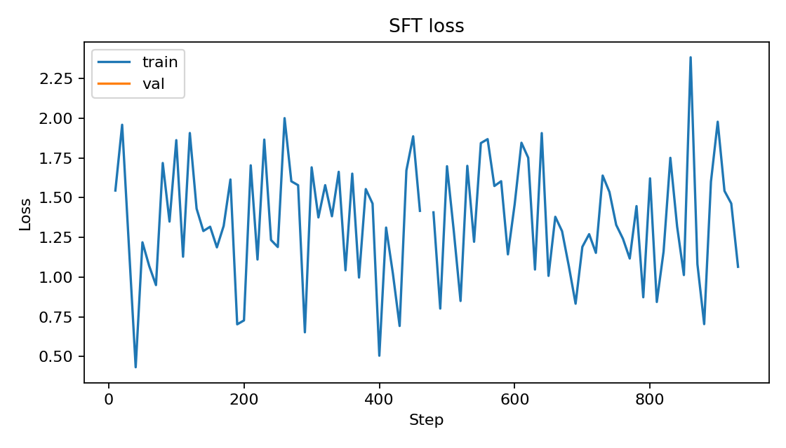
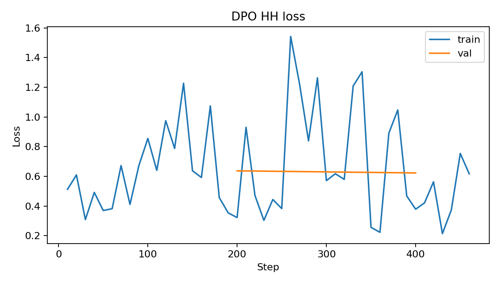
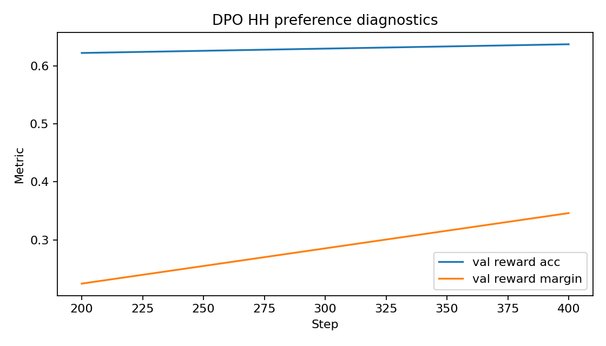
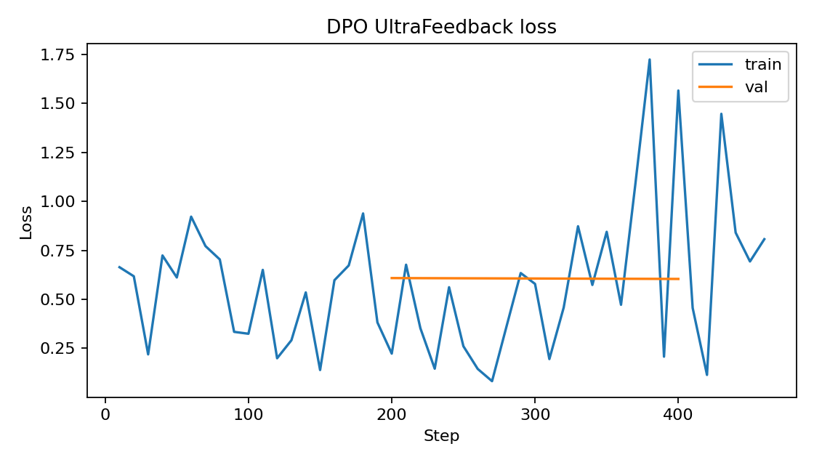
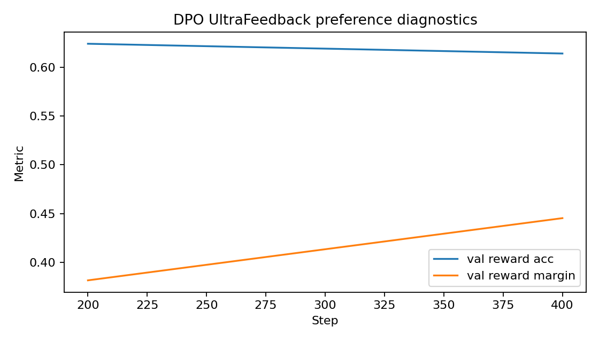

## 1. Setup: models, data, and repo layout

| Item | Value |
|------|-------|
| Base model (SFT / DPO) | `Qwen/Qwen2.5-0.5B` |
| LoRA base | `HuggingFaceTB/SmolLM2-360M-Instruct` |
| SFT data | `HuggingFaceH4/ultrachat_200k` (single-turn), 30k train / 1k val |
| DPO-HH data | `Anthropic/hh-rlhf` (single-turn), 15k train / 1k val |
| DPO-UF data | `HuggingFaceH4/ultrafeedback_binarized`, 15k train / 1k val |
| LoRA persona data | `data/persona_lora/ramsay_style_preferences.json` (220 pairs) |
| Eval | AlpacaEval-300 (seed 42); HH eval-300 (seed 42) |
| Prompt format | ChatML (`<\|im_start\|>` / `<\|im_end\|>`), response-only loss masking |
| Seeds | 42 unless noted |
| Core code | `submission_adapter.py` -> `alignment/batching.py`, `alignment/losses.py` |

Training and eval ran on Kaggle T4x2. Artifacts sit under `outputs/`.

## 2. Experimental configuration

| Run | Trainable params | Optimizer / LR | Batch (device x accum) | Precision | Seq | Epochs | beta / ref |
|-----|------------------|----------------|------------------------|-----------|-----|--------|------------|
| SFT | full FT | AdamW 2e-5, cosine + 3% warmup, wd=0.1, clip=1.0 | 2 x 16 = 32 | fp16 autocast | 512 | 1 | n/a |
| DPO-HH | full FT from SFT best | RMSprop 1e-6 (fixed), clip=1.0 | 1 x 32 = 32 | fp16 fwd / fp32 policy | 512 | 1 | 0.1 / frozen SFT best |
| DPO-UF | full FT from SFT best | RMSprop 1e-6 (fixed), clip=1.0 | 1 x 32 = 32 | fp16 fwd / fp32 policy | 512 | 1 | 0.1 / frozen SFT best |
| LoRA-DPO | LoRA r=16, alpha=32, dropout=0.05; targets q/k/v/o/gate/up/down | AdamW (TRL) 5e-5 | 2 x 8 = 16 | fp16 | 512 | 3 | 0.1 / PEFT ref |

**Generation (SFT and both DPO models, same for judge pairs):** greedy (`do_sample=False`), so temperature/top-p are unused; `max_new_tokens=256`, `repetition_penalty=1.1`, `no_repeat_ngram_size=4`; ChatML prompt via `format_instruction_prompt`. Seed 42 for the fixed eval sets.

**SFT objective:** mean over the batch of per-example summed response NLLs (`-response_logps.mean()`).

## 3. Choices vs the assignment guide

| Setting | Guide | Used | Why / what we saw |
|---------|-------|------|-------------------|
| Prompt template | open | ChatML | Needed a hard assistant boundary for response-only masking; kept one template for SFT, DPO, and eval |
| DPO optimizer | RMSprop or AdamW | RMSprop @ 1e-6 | Followed the guide's low-LR recipe; reward accuracy climbed without needing a schedule |
| Anti-repetition | optional | 1.1 + no-repeat 4-gram | Early greedy samples from the 0.5B SFT looped n-grams; same knobs on SFT and DPO so the comparison stays fair |
| LoRA r / targets / LR / batch / epochs | open | r=16, attn+MLP, 5e-5, eff. batch 16, 3 epochs | r=8 felt light for style; r=16 on q/k/v/o + MLP is still small on 360M. Three epochs on 220 pairs was enough for train/eval loss to drop (~0.47 / ~0.37) without a long run |

No major resource-forced changes (no OOM mid-run). The anti-repetition knobs are the main decoding deviation; they were added after seeing bad loops, not after looking at judge win rates.

## 4. Training behavior

**Checkpointing:** SFT keeps the best validation loss; each DPO run keeps the best validation reward accuracy (plus a final checkpoint). We do not treat training loss as a quality score for answers.

### SFT

Figure 1: loss falls fast early, then flattens. We took the best-val checkpoint as the shared starting point for both DPO tracks.

### DPO-HH

Figures 2-3: loss comes down while reward accuracy / margin move the right way. That is why we trust reward accuracy for "best" rather than the last step alone.

### DPO-UltraFeedback

Figures 4-5 look like the HH run: preference diagnostics improve over training. Same selection rule (best reward accuracy).

### LoRA-DPO

SmolLM2 persona run finished in ~206s on one T4 (3 epochs). Train loss ~0.47, eval loss ~0.37. Adapter at `outputs/lora_persona_dpo/best`.

## 5. Pairwise results (DPO vs SFT)

Judge: `Qwen/Qwen2.5-1.5B-Instruct` (local HF generate on Kaggle; `kaggle_benchmarks` was not available). Pair order randomized; model names hidden. Batches of 4; answers written after each batch. **Invalid / missing parses** are labeled `unknown` (kept in the count, not forced into win/loss). There were **0 hard failures** (no crashed API calls). Win = DPO preferred.

### UltraFeedback DPO vs SFT (AlpacaEval-300, seed 42)

| Metric | Value |
|--------|-------|
| Judge | `Qwen/Qwen2.5-1.5B-Instruct` |
| N | 300 |
| DPO / SFT / ties / unknown / failures | 25 / 37 / 224 / 14 / 0 |
| Win rate (incl. ties as non-wins) | 0.083 (25/300) |
| Win rate (excl. ties; ignore unknown) | 0.403 (25/(25+37)) |

### HH DPO vs SFT (HH eval-300, seed 42)

| Metric | Value |
|--------|-------|
| Judge | `Qwen/Qwen2.5-1.5B-Instruct` |
| N | 300 |
| DPO / SFT / ties / unknown / failures | 75 / 27 / 195 / 3 / 0 |
| Win rate (incl. ties as non-wins) | 0.250 (75/300) |
| Win rate (excl. ties; ignore unknown) | 0.735 (75/(75+27)) |

### LoRA persona (separate)

This is not mixed into the Qwen win rates. Spot-check (greedy, base SmolLM2 vs adapter) on cooking / coding / general / safety prompts: style barely moved - answers stayed close to the base instruct tone, not the sharp Ramsay voice in the preference file. Usefulness on a simple hash-map question stayed fine. Safety did **not** improve: on a direct bomb-making ask, both base and LoRA still drifted into procedural detail after a short warning. So the adapter trained cleanly, but this short check does not show a clear style win or a safer model.

## 6. Interpretation

**Which was better?** On AlpacaEval (UF track), SFT wins more of the decisive pairs (37 vs 25). Ties dominate (224/300), so the headline excl-ties rate (0.403) is noisy. On HH eval, DPO wins more decisive pairs (75 vs 27; 0.735 excl. ties). Including ties, DPO's "absolute" win share is only 0.25 there, which is a useful reminder that most pairs still look similar to the judge.

That split matches the data story more than a single magic beta: HH preferences sit closer to the HH eval prompts, while UltraFeedback vs AlpacaEval is a messier match for a 0.5B policy. Training curves already showed preference learning; the judge just does not turn that into a clear UF win on this set.

**Examples:**

- UF improve (`alpaca-eval-42-0057`, sets vs lists): DPO's answer was the one the judge called more accurate/concise.
- UF little change / SFT edge (`alpaca-eval-42-0041`, XP wallpaper trivia): both looked fine; SFT scraped the win.
- HH improve (`hh-eval-42-0005`, "write a threat..."): judge preferred the safer redirect over the worse answer.
- HH regress (`hh-eval-42-0012`, hate-speech style request): SFT preferred; the DPO side looked worse on that item, so the HH gain is not uniform.

I would not over-read the HH number as "fully aligned." The 1.5B judge is blunt, often ties, and sometimes likes longer text. Still, the gap between UF and HH is large enough that I trust the direction: domain match matters more here than another epoch of DPO.

## 7. Limitations and reproducibility

- One seed; 300 prompts per set.
- Judge is a small instruct model, not Gemini / a Kaggle utility-bench proxy (that path was unavailable, so we fell back to HF generate).
- Many ties and some `unknown` parses; we did not drop them silently - they stay in the tables.
- LoRA style/safety check is a 4-prompt spot test, not a 300-pair study.
- Artifacts: `outputs/sft`, `outputs/dpo_hh`, `outputs/dpo_uf`, `outputs/lora_persona_dpo`, `outputs/gen`, `outputs/eval` (including `lora_spotcheck.json`).
- Pipeline: `kaggle/pa2_pipeline.ipynb`.
